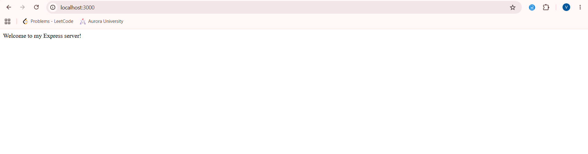
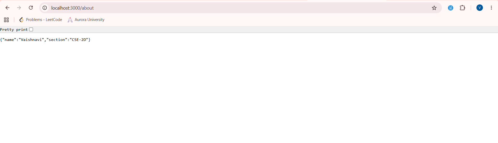
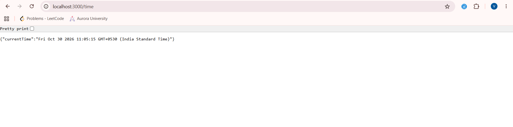
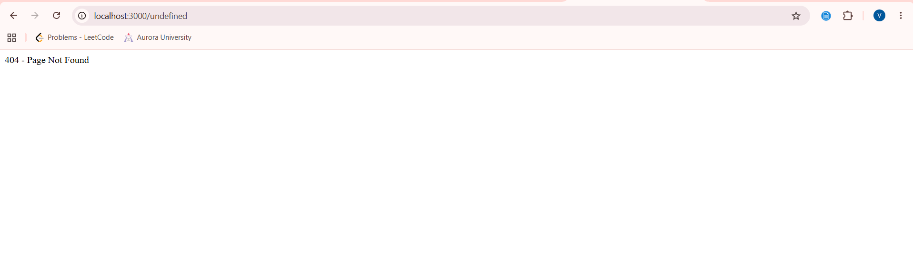

# Lab 1: Node.js and Express Server

## Student Details

- **Name:** Vaishnavi
- **Registration Number:** [Enter Your Registration Number]
- **Section:** CSE-2D
- **Course:** Backend Development Fundamentals

## Live Link

Not deployed. The server currently runs locally at:

`http://localhost:3000`

## Objective

The objective of this lab is to understand Node.js and Express.js by creating a basic HTTP server, setting up an Express server, creating different routes, and handling unknown routes using a 404 error response.

## Technologies Used

- Node.js
- Express.js
- JavaScript
- Visual Studio Code
- Git and GitHub

## Project Structure

```text
lab-01/
│
├── screenshots/
│   ├── welcome.png
│   ├── about.png
│   ├── time.png
│   └── 404error.png
│
├── basic-server.js
├── server.js
├── package.json
├── package-lock.json
├── .gitignore
└── README.md
```

## Installation and Setup

### Step 1: Initialize the project

```bash
npm init -y
```

### Step 2: Install Express

```bash
npm install express
```

### Step 3: Run the basic Node.js HTTP server

```bash
node basic-server.js
```

### Step 4: Run the Express server

```bash
npm start
```

The Express server runs at:

`http://localhost:3000`

## Environment Variables

No environment variables are required for this lab.

The server uses port 3000.

## Endpoints

| HTTP Method | Endpoint | Description | Status Code |
|---|---|---|---|
| GET | `/` | Displays the welcome message. | 200 |
| GET | `/about` | Displays student name and section in JSON format. | 200 |
| GET | `/time` | Displays the current date and time. | 200 |
| GET | Any unknown path | Displays a 404 error message. | 404 |

## Output Screenshots

### 1. Welcome Page

Displays the welcome message when the root route is accessed.



### 2. About Page

Displays student information in JSON format.



### 3. Time Route

Displays the current date and time.



### 4. 404 Error Page

Displays an error message when an unknown route is accessed.



## Problems Faced and Solutions

1. **PowerShell Execution Policy Error:** Initially, npm commands were blocked because script execution was disabled. This was solved by changing the execution policy for the current user.

2. **Module Not Found Error:** Initially, Node.js could not find the server file because the terminal was in the wrong directory. This was solved by navigating to the `lab-01` folder.

3. **Connection Refused Error:** The browser could not connect when the server was not running. This was solved by starting the server using the correct command.

4. **Git Push Rejection:** GitHub initially rejected the push because the remote repository contained changes. This was resolved by pulling the remote changes and merging them before pushing again.

## Conclusion

Through this lab, I learned how to create a basic HTTP server using Node.js and build an Express server. I also learned how to create GET routes, send JSON responses, display the current date and time, and handle unknown routes using a 404 status code.

This lab helped me understand the basics of backend development and how servers handle client requests.

---
**Lab 01 – Backend Development Fundamentals**
